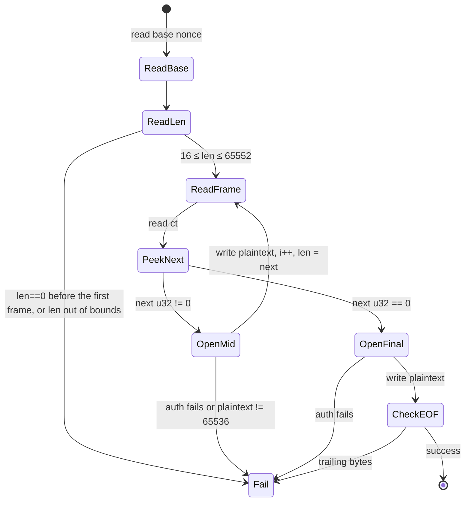

# Data Model: Review Remediation

## Container version

| Value | Name | Write | Read |
|---|---|---|---|
| `0x01` | format v1 | Test code only (vector generator, tamper tests) | Yes, with the stricter checks in R1 |
| `0x02` | retired pre-release | Never | Rejected: "unsupported version" |
| `0x03` | format v2 | Default for every new file | Yes |
| other | — | Never | Rejected: "unsupported version" |

`entities.EncryptedFile.Version` (exists, `encrypted_file.go`) carries the value. `Validate()`
accepts `1` and `3`.

## EncryptedFile (changes)

| Field | v1 | v2 |
|---|---|---|
| `Version` | 1 | 3 |
| `Chunked` | required | required |
| `KeyID`, `RecipientKeyID`, `EphemeralPubKey`, `Nonce`, `EncryptedData` | single-recipient method 2 | MUST be empty |
| `Recipients[].FingerprintHint` | required | MUST be empty |
| `Recipients[].EphemeralPubKey`, `.Nonce`, `.WrappedCEK` | required | required (1 to 16 blocks) |
| `Salt` | 32 B (PBKDF2) | 16 B (Argon2id) |
| `KDF` | `"pbkdf2-sha256-600k"` | `"argon2id"` |
| `KDFParams{M,T,P}` (new) | absent | required, exactly `65536, 3, 4` |
| `PolicyID` | method 5 | method 5 |

Validation rules:

- A v2 header with any v1-only field fails with a parse error (exit 1).
- A v2 method-2 header with 0 or more than 16 blocks fails with a parse error.
- A v2 method-3 header with other KDF parameters fails with a parse error before any KDF runs.

## Stream frame

| Version | Frame | Nonce | AAD |
|---|---|---|---|
| v1 | `u32 len, nonce(12), ct` | on-wire, MUST equal `base XOR u64be(i)` | `headerAAD` |
| v2 | `u32 len, ct` | derived `base XOR u64be(i)` | `headerAAD ‖ u64be(i) ‖ u8(final)` |

Bounds for both versions: `16 ≤ len ≤ 65536+16`. In v2, a non-final frame has `len == 65536+16`.
The terminator is `u32(0)`. After the terminator, the input MUST end.

State of the v2 decoder:

## StagedWriter (internal port)

| State | Write | Commit | Abort |
|---|---|---|---|
| open | appends to the temporary file | fsync, close, rename → committed | close, remove → aborted |
| committed | error | no-op, returns nil | no-op, returns nil |
| aborted | error | error | no-op, returns nil |

The temporary file is `<dir>/.<base>.<random>.mdstn-partial`, mode `0600`, created with `O_EXCL`.

## Error classes

| Sentinel | Exit | Raised when |
|---|---|---|
| none | 0 | success |
| any other error | 1 | usage, parse, I/O, invalid recipient key, unsupported version |
| `ErrHeaderAuthFailed` | 2 | header or body authentication fails, except the method-3 case below. Includes `ChunkAuthError{Index}` |
| `ErrNotARecipient` | 3 | no block opens with any usable local key |
| `ErrWrongPassword` (new) | 4 | method 3: the single frame or chunk 0 fails authentication |

## Recipient input (CLI)

| Source | Flag | Resolves to |
|---|---|---|
| email | `--for`, `--recipient a@b` | CKD lookup |
| local key ID or fingerprint | `--recipient <id>` | key repository |
| raw public key | `--recipient-key <b64|path>` (new, repeatable) | 32-byte key, validated |
