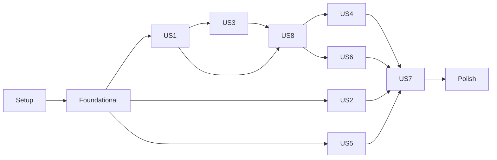

---

description: "Task list for the review remediation (2026-11-04)"
---

# Tasks: Review Remediation (2026-11-04)

**Input**: Design documents from `specs/001-review-remediation/`

**Prerequisites**: plan.md, spec.md, research.md, data-model.md, contracts/, quickstart.md

**Tests**: REQUIRED. The constitution (Quality Gates) requires a regression test that fails before
each security fix and passes after it. Write each test task before its implementation task and
confirm that it fails first.

**Organization**: one phase per user story, in the order of dependencies and priority.

## Format: `[ID] [P?] [Story] Description`

- **[P]**: can run in parallel (different files, no dependency on an open task)
- **[Story]**: the user story (US1-US8 in spec.md)

---

## Phase 1: Setup

- [X] T001 Record the baseline: run `go test ./... -count=1` and `task lint`, and save the results in specs/001-review-remediation/baseline.txt (delete the file in T070)
- [X] T002 Add a `## Unreleased` section for `v0.3.0` to CHANGELOG.md (create the file if it does not exist) with one placeholder heading per user story

---

## Phase 2: Foundational (blocking)

**Purpose**: shared error classes and the staged-output port. Every story uses them.

- [X] T003 [P] Add `ErrWrongPassword` ("wrong file password, or the file is damaged"), `ErrInvalidRecipientKey`, and `ChunkAuthError{Index uint64}` (with `Error()` and `Is(target) bool` that matches `ErrHeaderAuthFailed`) to internal/core/entities/errors.go
- [X] T004 [P] Add unit tests for `ChunkAuthError` `errors.Is` behavior in internal/core/entities/errors_test.go
- [X] T005 Add the `StagedWriter` interface (`io.Writer`, `Commit() error`, `Abort() error`) and change `FileHandler.WriteStream` to return `(StagedWriter, error)` in internal/core/usecases/ports.go (data-model.md §StagedWriter: "committed: Write error, Commit no-op nil, Abort no-op nil; aborted: Write error, Commit error, Abort no-op nil")
- [X] T006 Write failing tests for the staged writer in internal/adapters/cli/file_handler_test.go: Abort leaves no file; Commit publishes; a planted symlink at `<out>.tmp` and at `<out>.mdstn.tmp` stays unchanged; the state table from data-model.md
- [X] T007 Implement `stagedWriter` with `os.CreateTemp(dir, "."+base+".*.mdstn-partial")`, mode 0600, `Commit` = fsync + close + rename, `Abort` = close + remove (idempotent), in internal/adapters/cli/file_handler.go. Change `WriteFile` to use the same staging. Remove `atomicWriter`
- [X] T008 In internal/adapters/cli/file_handler.go, remove `*.mdstn-partial` files older than 1 hour in the output directory before staging (best effort, WARN log). Change `CleanupStaleTempFiles` to match `*.mdstn-partial` and the legacy `*.mdstn.tmp`
- [X] T009 Change `fakeFileHandler`/`fakeWriteCloser` to the new `StagedWriter` contract in internal/core/usecases/encrypt_file_test.go
- [X] T010 Replace `context.Background()` with `signal.NotifyContext(ctx, os.Interrupt, syscall.SIGTERM)` in each RunE of cmd/*_cobra.go through one helper `commandContext()` in cmd/root.go

**Checkpoint**: `go build ./...` and `go test ./internal/adapters/cli/... ./internal/core/...` pass.

---

## Phase 3: User Story 1 - Tampered stream files fail and leave no output (P1) 🎯 MVP

**Goal**: v1 stream decoding rejects reordered, repeated, removed, and oversized frames, and no
failed operation leaves output. (FR-001 to FR-005, FR-007)

**Independent Test**: quickstart.md §2 (v1 rows) and the tests below.

- [X] T011 [P] [US1] Add `TestDecryptStreamRejectsFrameManipulation` (swap, repeat, remove middle, bytes after terminator) from the review patch in internal/adapters/crypto/stream_frame_tamper_test.go. Do not add the skipped truncation test
- [X] T012 [P] [US1] Add `TestDecryptStreamBoundsChunkLength` in internal/adapters/crypto/stream_frame_tamper_test.go: a 28-byte input (base nonce, length 0xFFFFFFF0, chunk nonce) fails, reads no more than 28 bytes, and grows `runtime.MemStats.TotalAlloc` by less than 1 MiB
- [X] T013 [US1] In internal/adapters/crypto/aes.go add `streamChunkNonce(base, i)`. Use it in `EncryptStream`. In `DecryptStream`, reject `chunkLen > streamChunkSize+gcm.Overhead()` before allocation, reject an on-wire nonce that differs from the derived nonce, return `entities.ChunkAuthError{Index: i}` on a GCM failure, and require EOF after the terminator
- [X] T014 [P] [US1] Add a usecase test with the real `cli.FileHandler` in tests/integration/staged_output_test.go: a bit flip in chunk 10 of 20 fails and no file exists at the output path; an encryption whose source fails mid-stream leaves no `.mdstn` file
- [X] T015 [US1] On the DecryptStream error path in internal/core/usecases/decrypt_file.go (`decryptStream`), call `writer.Abort()` and join the abort error with `errors.Join`. On success call `Commit()`
- [X] T016 [US1] On the 8 encrypt error paths in internal/core/usecases/encrypt_file.go (lines 212, 216, 379, 383, 511, 515, 873, 877), call `writer.Abort()` and join its error. On success call `Commit()`
- [X] T017 [US1] Add a cancellation test in tests/integration/staged_output_test.go: cancel the context during a 5 MiB encryption and decryption, and check that no output file remains

**Checkpoint**: v1 frame tampering fails with exit class `ErrHeaderAuthFailed` and leaves no file.

---

## Phase 4: User Story 2 - Unattended encryption to a public key (P1)

**Goal**: encrypt without a TTY, to a raw public key, from the CLI and the SDK. (FR-008 to FR-012)

**Independent Test**: quickstart.md §3 and §5 (`TestInMemory`).

- [X] T018 [P] [US2] Add `secretFromFile(path string) (string, error)` (path or `-` for stdin, one trailing `\n` or `\r\n` removed, empty result is an error) with table tests in cmd/secretinput.go and cmd/secretinput_test.go
- [X] T019 [P] [US2] Add `parseRecipientKey(v string) ([]byte, error)` in cmd/recipient_key.go: base64 of exactly 32 bytes, else a path whose trimmed content is that base64. Reject a low-order point with a trial X25519 (all-zero output) and return `entities.ErrInvalidRecipientKey`. Add table tests in cmd/recipient_key_test.go
- [X] T020 [US2] Add `--recipient-key` (repeatable), `--password-file`, and `--key-passphrase-file` to cmd/encrypt_cobra.go. Enforce the rules in contracts/cli.md §encrypt: inline flag + file flag → usage error; recipient flags + password flag → usage error
- [X] T021 [US2] In cmd/encrypt.go, prompt for a file password only when `passphrase == "" && forEmail == "" && len(recipients) == 0` (recipients from `--recipient` and `--recipient-key`). Append parsed raw keys to the recipient list with `cipher.Fingerprint` for display
- [X] T022 [US2] Add `--password-file` and `--key-passphrase-file` to cmd/decrypt_cobra.go and cmd/decrypt.go. When no TTY and no secret is available, return an error that names the missing flag
- [X] T023 [US2] Add `--key-passphrase-file` to `keys create` in cmd/keys_cobra.go and cmd/keys.go with the priority `--key-passphrase` > `--key-passphrase-file` > `MDSTN_KEY_PASSPHRASE` > prompt
- [X] T024 [US2] Add a CLI test in cmd/encrypt_notty_test.go: build the binary, run `encrypt --recipient-key <pub>` with stdin from `/dev/null` in an empty `--db` directory, and check exit 0, no prompt text, and 0 keys in the encrypting key store
- [X] T025 [P] [US2] In internal/adapters/sqlite/identity_key_repo.go, call `db.SetMaxOpenConns(1)` when `dbPath == ":memory:"`. Add a test that two repositories on one `:memory:` client share the schema
- [X] T026 [US2] Add `const InMemory = ":memory:"` to pkg/cipher/client.go. In `New`, do not apply the default path when `cfg.DBPath == InMemory`. Validate `Recipient.PublicKey` with the rule from T019 before any output (move the validator to internal/adapters/crypto/x25519.go as `ValidatePublicKey` and call it from cmd and pkg)
- [X] T027 [US2] Add `TestInMemoryEncryptToPublicKey` in pkg/cipher/inmemory_test.go: `New(Config{DBPath: InMemory})`, encrypt to a raw public key, check that no file appears in `t.TempDir()` or `$HOME/.mdstn` (set `HOME` to a temp dir), and decrypt with a second client that holds the key

**Checkpoint**: quickstart.md §3 passes.

---

## Phase 5: User Story 3 - Scripts can tell failures apart (P2)

**Goal**: exit codes 0-4, and one error class for a wrong password in both framings.
(FR-013, FR-014)

**Independent Test**: quickstart.md §4.

- [X] T028 [P] [US3] Add `ExitCode(err error) int` in cmd/exit.go (`ErrHeaderAuthFailed` → 2, `ErrNotARecipient` → 3, `ErrWrongPassword` → 4, nil → 0, other → 1) with a table test in cmd/exit_test.go
- [X] T029 [US3] In cmd/mdstn-cipher/main.go call `os.Exit(cmd.ExitCode(err))`. In cmd/encrypt.go:121 return the `ErrRecoveryAborted` error with its message, do not call `os.Exit`. Change the `os.Exit(1)` calls in cmd/root.go `initConfig` to return errors through `PersistentPreRunE`
- [X] T030 [US3] In internal/core/usecases/decrypt_file.go, map method-3 failures: single-frame GCM failure or `ChunkAuthError{Index: 0}` → `ErrWrongPassword`. `ChunkAuthError{Index > 0}` → `ErrHeaderAuthFailed`. Remove the blanket `ErrHeaderAuthFailed` wrap at `decryptStream`
- [X] T031 [US3] Add `TestExitCodes` in cmd/exit_codes_cli_test.go: build the binary and run one case each for exit 0, 1 (bad flag), 2 (tampered recipient file), 3 (file for another key), 4 (wrong password on a 1 KiB file and on a 2 MiB file, same message)

**Checkpoint**: quickstart.md §4 passes.

---

## Phase 6: User Story 8 - New files resist truncation, key substitution, and recipient linking (P2)

**Goal**: container `0x03` is the default for new files. (FR-006, FR-022 to FR-027)

**Independent Test**: quickstart.md §2 (v2 rows) and the tests below.

### Tests first

- [X] T032 [P] [US8] Add `TestStreamV2Truncation` in internal/adapters/crypto/stream_v2_test.go: for plaintext sizes 0, 1, 65535, 65536, 65537, 3×65536, and 3×65536+5, truncate at each frame boundary with and without a terminator, and append bytes after the terminator. Each case fails with `ChunkAuthError` or a parse error
- [X] T033 [P] [US8] Add `TestStreamV2Frames` in internal/adapters/crypto/stream_v2_test.go: swap, repeat, remove, forged length > 65552, a non-final frame with plaintext ≠ 65536, and `len == 0` as the first frame all fail
- [X] T034 [P] [US8] Add `TestWrapCEKv2BindsKeys` in internal/adapters/crypto/x25519_v2_test.go: an unwrap with the v1 KDF fails on a v2 block; a block re-targeted to another recipient public key fails
- [X] T035 [P] [US8] Add header tests in internal/adapters/crypto/mdstn_format_v2_test.go: a v2 header with any of `key_id`, `recipient_key_id`, `fingerprint_hint`, top-level `ephemeral_pub_key`, `nonce`, or `encrypted_data` fails to parse; a method-3 header with `m`, `t`, or `p` other than `65536, 3, 4` fails before any KDF runs; version `0x02` fails with "unsupported version"; version flip `0x03 ↔ 0x01` fails authentication

### Implementation

- [X] T036 [US8] In internal/core/entities/encrypted_file.go, add `KDFParams{M, T, P uint32}`. Change `Validate()` to accept `Version` 1 and 3 and apply the v2 rules from data-model.md §EncryptedFile ("A v2 header with any v1-only field fails with a parse error"; "0 or more than 16 blocks fails"; "other KDF parameters fails")
- [X] T037 [US8] Change the `CryptoEngine` port in internal/core/usecases/ports.go per contracts/sdk.md §pkg/cipherports: `DecryptStream(..., version uint8)`, `UnwrapCEK(..., version uint8)`, new `DeriveFileKeyArgon2id(password string, salt []byte) ([]byte, error)`. Add `FileEncoder.DecodeHeader(r io.Reader) (*entities.EncryptedFile, []byte, error)`
- [X] T038 [US8] Move the v1 stream encoder from internal/adapters/crypto/aes.go to internal/adapters/crypto/stream_v1_encoder_test.go as `encryptStreamV1` (test-only). Change `EncryptStream` in aes.go to write the v2 framing from contracts/format-v2.md §Body (read one chunk ahead for `final`). Make `DecryptStream` dispatch on `version` (1: R1 rules; 3: v2 state machine in data-model.md)
- [X] T039 [US8] In internal/adapters/crypto/x25519.go, make `WrapCEK` use `HKDF-SHA256(ikm=shared, salt=eph_pub||R_pub, info="mdstn-cipher/v2/wrap")` and wrap AAD `"mdstn-cipher/v2/wrap-cek"`. Make `UnwrapCEK` select the v1 or v2 KDF from `version` (derive `R_pub` from the private key)
- [X] T040 [P] [US8] Add `DeriveFileKeyArgon2id` (m=65536, t=3, p=4, 32-byte key, 16-byte salt) in internal/adapters/crypto/argon2id.go
- [X] T041 [US8] In internal/adapters/crypto/mdstn_format.go, write version `0x03` with the v2 JSON schema (contracts/format-v2.md §Header). Decode both versions. Reject `0x02` and unknown versions. Implement `DecodeHeader(r)` (read 8 bytes, then `HeaderLen` bytes)
- [X] T042 [US8] In internal/core/usecases/encrypt_file.go, write v2 headers for all paths: encrypt for self and `--for` become one recipient block; `encryptWithPassphrase` uses `DeriveFileKeyArgon2id` with a 16-byte salt and `KDFParams{65536,3,4}`; remove `generateFingerprintHint` from the encode path and remove `_ = wrapNonce` (line 350)
- [X] T043 [US8] Extract a reader/writer core `EncryptFile.EncryptStream(ctx, src io.Reader, dst io.Writer, req)` in internal/core/usecases/encrypt_file.go (always `chunked=true`). Make the file paths call it through `ReadStream` and `StagedWriter`
- [X] T044 [US8] In internal/core/usecases/decrypt_file.go, replace the whole-file `ReadFile` (line 77) with `ReadStream` + `DecodeHeader`. Extract `DecryptFile.DecryptStream(ctx, src, dst, req)`. Dispatch v1 and v2 rules on `encFile.Version`
- [X] T045 [US8] In internal/core/usecases/decrypt_file.go, add v2 recipient resolution: for each block, try each usable local X25519 key (the default key first, then non-expired keys by last use), with `UnwrapCEK(..., 3)`. Keep the v1 hint scan for v1 files. Return `ErrNotARecipient` when no block opens
- [X] T046 [US8] Update internal/mcp/server.go and tests/integration/*.go for the changed usecase and port signatures. Run `go test ./... -count=1`

**Checkpoint**: new files are `0x03`. All v1 fixtures still decrypt. T032-T035 pass.

---

## Phase 7: User Story 4 - Implementers can follow the format spec (P2)

**Goal**: a reimplementation-grade spec and vectors for v1 chunked and every v2 method and framing.
(FR-015 to FR-017, FR-026)

**Independent Test**: quickstart.md §6.

- [X] T047 [US4] Change internal/adapters/crypto/generate_vectors_test.go to write a fixture only when the file does not exist, so existing fixtures stay byte-identical. Add vectors `v1-passphrase-chunked` (with `encryptStreamV1`, 3 full chunks + 5 bytes), `v2-x25519-single`, `v2-x25519-multi`, `v2-passphrase`, `v2-sharedkey` (crypto layer, fixed 32-byte policy key), each for `chunked=false` and `chunked=true`
- [X] T048 [US4] Regenerate with `CIPHER_REGENERATE_VECTORS=1 go test -run TestGenerateVectors ./internal/adapters/crypto/`. Check with `git diff --stat internal/testdata/` that only new files and new `vectors.json` entries changed
- [X] T049 [US4] Extend internal/adapters/crypto/vectors_conformance_test.go to decrypt stream bodies and both versions, and to fail when a framing or a v2 method has no vector
- [X] T050 [US4] Add the v1 and v2 frame rows of contracts/format-v2.md §Tamper contract to `TestAADTamperMatrix` in internal/adapters/crypto/aad_tamper_test.go, with the expected class per row
- [X] T051 [P] [US4] Fix docs/format-spec.md per review F8: multi-recipient pseudocode uses `recipient["nonce"]` and the full `wrapped_cek`; the bundle pseudocode passes `aad="mdstn-wrapped-key:" + key_id`; remove the duplicate heading (lines 404-406); RFC 7914 → RFC 9106 for Argon2
- [X] T052 [US4] Add to docs/format-spec.md: v1 stream pseudocode (with the derived-nonce check and the length bound), the frame-level tamper contract, a §Limitations entry "v1 cannot detect truncation at a chunk boundary", and a complete "Format v2 (version 0x03)" section from contracts/format-v2.md with pseudocode for each method and framing
- [X] T053 [US4] Update docs/format-spec.md §Governance: item 2 says "the next unused version byte", record that `0x02` is retired and `0x03` is format v2 (frozen at this release), and update the version table and line 18 and line 36
- [X] T054 [P] [US4] Fix cmd/encrypt_cobra.go help text: the default without flags is "encrypt for yourself with your default key", number the examples 1-4 in order, and add `--recipient-key` and `--password-file` examples. Remove "(version 2)" from the comments at internal/core/usecases/encrypt_file.go:124, :297, :458

**Checkpoint**: quickstart.md §6 passes.

---

## Phase 8: User Story 5 - Safe temporary files (P3)

**Goal**: no predictable temporary names, cleanup of all stale staged files. (FR-019)

**Independent Test**: quickstart.md §7.

- [X] T055 [US5] Add a stale-file test in internal/adapters/cli/file_handler_test.go: a `*.mdstn-partial` file with an mtime older than 1 hour in the output directory is removed on the next write, and a newer one stays
- [X] T056 [US5] Change `exportKey` in internal/mcp/server.go (raw `os.WriteFile`, line 318) to use `FileHandler.WriteFile`

**Checkpoint**: T006, T055 pass.

---

## Phase 9: User Story 6 - Honest SDK surface (P3)

**Goal**: working SDK stream methods. (FR-018)

**Independent Test**: quickstart.md §5 (`TestStream`).

- [X] T057 [US6] Write `TestStreamRoundTrip` in pkg/cipher/stream_test.go: 10 MiB through `bytes.Buffer` for recipients, password, and for-me intents; no file appears in the working directory or `$HOME/.mdstn`; a tampered stream returns an error that matches `ErrHeaderAuthFailed`; a wrong password matches `ErrWrongPassword`
- [X] T058 [US6] Replace the stubs in pkg/cipher/encrypt.go with `EncryptStream(ctx, src, dst, EncryptStreamInput) error` and `DecryptStream(ctx, src, dst, DecryptStreamInput) (*DecryptStreamResult, error)` per contracts/sdk.md. Call the usecase stream cores from T043 and T044. Document the "discard dst on error" rule
- [X] T059 [US6] Export `ErrWrongPassword` and `ErrInvalidRecipientKey` in pkg/cipher/aliases.go. Update `pkg/cipherports/ports.go` aliases and pkg/cipher/doc.go
- [X] T060 [US6] Update tests/external-sdk/main.go to round-trip through `EncryptStream`/`DecryptStream` as well as the file methods

**Checkpoint**: `go test ./pkg/...` and `bash tests/external-sdk/run.sh` pass.

---

## Phase 10: User Story 7 - Error discipline and CI stay green (P3)

**Goal**: lint flags silent discards, CI passes. (FR-020, FR-021)

**Independent Test**: `task ci` on a clean checkout. A new `_ = f()` fails lint.

- [X] T061 [US7] In tests/external-sdk/main.go, replace the `filePassword` constant with `rand.Text()` at runtime (V3)
- [X] T062 [US7] Set `linters.settings.errcheck.check-blank: true` in .golangci.yml
- [X] T063 [US7] Triage the remaining non-test `_ =` discards per research.md R9: log `keyRepo.Update` failures at WARN (encrypt_file.go:283, decrypt_file.go:298, :402, :509); panic in `init` on `MarkHidden`/`MarkFlagRequired` errors (cmd/decrypt_cobra.go:32, cmd/encrypt_cobra.go:44, cmd/keys_cobra.go:140, :144); add `//nolint:errcheck // best-effort: <reason>` to the remaining cleanup sites (cmd/backup.go, internal/adapters/ckd/client.go:166, sqlite migrate calls, session store calls, cmd/restore.go:143, cmd/keys.go:84, cmd/lookup.go:50, cmd/version.go:33)
- [X] T064 [US7] Run `task lint` and fix each new report until it reports zero issues

**Checkpoint**: `task ci` passes.

---

## Phase 11: Polish & cross-cutting

- [X] T065 [P] Update README.md and AGENTS.md: format v2 is the default, v1 is read-only, the new CLI flags, the exit codes
- [X] T066 [P] Fill the CHANGELOG.md `v0.3.0` section: each public change from contracts/sdk.md, the rollout note for v2 readers, and the v1 truncation limitation
- [X] T067 Run the review reproduction script (quickstart.md §2) against the new binary and record the results table in specs/001-review-remediation/quickstart.md §2
- [X] T068 Run `task ci`, `task fork-boundary`, and `bash tests/external-sdk/run.sh`
- [X] T069 Benchmark a 100 MiB encrypt and decrypt for v1 (test encoder) and v2 with `go test -bench Stream ./internal/adapters/crypto/` and check the 10% throughput goal from plan.md
- [X] T070 Delete specs/001-review-remediation/baseline.txt and any throwaway scripts

---

## Dependencies & Execution Order

- US2 needs only Phase 2. It can run in parallel with US1.
- US8 needs US1 (strict v1 decoder, Abort paths) and US3 (error classes in the decrypt dispatch).
- US4 and US6 need the v2 code and the stream cores from US8.
- US7 runs last, because `check-blank` reports every open discard.

## Parallel Opportunities

- Phase 2: T003/T004 in parallel with T005-T008.
- US1: T011, T012, T014 (tests) in parallel. Then T013 and T015/T016.
- US2: T018, T019, T025 in parallel. Then T020-T024, T026, T027.
- US8: T032-T035 (tests) and T040 in parallel. Then T036 → T037 → T038/T039/T041 → T042-T046.
- US4: T051 and T054 in parallel with T047-T050.

## Implementation Strategy

1. **MVP**: Phases 1-3 (US1). This closes F1, F3, and F4 for every existing file. It can ship
   alone as a patch release.
2. **Increment 2**: US2 + US3. The CronJob use case works, and scripts get exit codes.
3. **Increment 3**: US8 + US4. Format v2 with vectors and spec. Release `v0.3.0` only after US4.
4. **Increment 4**: US5, US6, US7, Polish.
