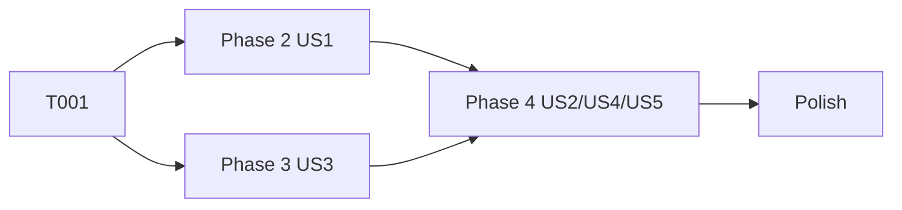

---

description: "Task list for QA remediation and the single container format"
---

# Tasks: QA Remediation and Single Container Format

**Input**: `specs/002-qa-remediation/{spec.md,plan.md}`
**Tests**: REQUIRED (constitution Quality Gates). Write each test first and confirm it fails.

## Phase 1: Setup

- [X] T001 Amend .specify/memory/constitution.md Principle III to v2.0.0: one container format (`0x03`); it freezes at the first release tag that ships it; `0x01` and `0x02` are retired

## Phase 2: US1 - One correct, committing, canonical format (P1) 🎯 MVP

- [X] T002 [P] [US1] Tests first in internal/adapters/crypto: two-CEK multi-recipient file fails with the tamper class (`header_mac_test.go`); version `0x01` and `0x02` fail with "unsupported version"; empty final frame after a full frame fails; CR/LF and non-canonical padding in any base64 header value fail to parse
- [X] T003 [P] [US1] Tests first for `ValidatePublicKey`: bit 255 set, `u = p`, `u = 2^255 − 1`, low-order points, 31 and 33 bytes are rejected; a real key passes (internal/adapters/crypto/x25519_validate_test.go)
- [X] T004 [US1] Remove all `0x01` decode and encode code: v1 stream decoder, v1 header fields and parsing, PBKDF2 file-key derivation, fingerprint-hint scan, legacy single-recipient unwrap, v1 KDF in `UnwrapCEK`, the `version` parameters that only select v1 (internal/adapters/crypto/*.go, internal/core/usecases/ports.go, pkg/cipherports/ports.go, internal/core/entities/encrypted_file.go)
- [X] T005 [US1] Delete v1 test helpers and tests (`encryptStreamV1`, `encodeHeaderV1`, `wrapCEKV1`, v1 cases in tamper/compat/crosslang tests, `v1_compat_usecase_test.go`), and the JS v1 fixtures in internal/testdata
- [X] T006 [US1] Strict base64 for every header value: reject `\r`/`\n`, decode with `base64.StdEncoding.Strict()` (internal/adapters/crypto/mdstn_format.go). Fix the comment at mdstn_format.go:184 (V2-8): the header is authenticated later, not when parsed
- [X] T007 [US1] Header MAC per plan R2: body = `header_mac(32) ‖ base_nonce ‖ frames` or `header_mac(32) ‖ nonce ‖ ct`. Derive `payload_key` and `mac_key` from the file key with HKDF. Verify with `hmac.Equal` before any body decryption (internal/adapters/crypto/aes.go or a new header_mac.go; port methods in internal/core/usecases/ports.go)
- [X] T008 [US1] Error classes per FR-003: method 2 unwrap OK + MAC fail → `ErrHeaderAuthFailed`; method 3 MAC fail → `ErrWrongPassword`; any body failure after a good MAC → `ErrHeaderAuthFailed`. Delete the chunk-0 relocation heuristic and `classifyPassphraseStreamError` special cases that the MAC makes obsolete (internal/adapters/crypto/aes.go, internal/core/usecases/decrypt_file.go)
- [X] T009 [US1] Final frame rule (R5): with more than one frame, the final frame holds ≥ 1 plaintext byte (internal/adapters/crypto/aes.go)
- [X] T010 [US1] Canonical `ValidatePublicKey` (R4) in internal/adapters/crypto/x25519.go. Call it for every recipient in `EncryptFile` recipient planning (internal/core/usecases/encrypt_file.go), so CKD, local key, raw key, SDK, and MCP paths are covered; return `ErrInvalidRecipientKey`
- [X] T011 [US1] Regenerate all vectors once: delete the old fixtures and vectors.json entries, keep the append-only generator for future additions, add stream lengths 0, 1, 65535, 65536, 65537, 131072 (method 3 and method 2 single) and a `negative` array (truncation + terminator, frame after final, frame 0 removed, empty final frame, two-CEK file, CR/LF header, version `0x01`) with `expect` class (internal/adapters/crypto/generate_vectors_test.go, internal/testdata/)
- [X] T012 [US1] Conformance test: every vector decrypts, every negative fixture fails with its class (internal/adapters/crypto/vectors_conformance_test.go). Tamper matrix updated for the MAC (aad_tamper_test.go)
- [X] T013 [US1] Update usecase, integration, and CLI tests for the single format (internal/core/usecases/*_test.go, tests/integration/*.go, cmd/*_test.go)
- [X] T014 [US1] Rewrite docs/format-spec.md for one format: byte layout with the header MAC, key schedule, canonical key rule, strict base64, canonical final frame, error classes, Python pseudocode per method and framing, negative fixtures, governance (0x01/0x02 retired, 0x03 freezes at its first release tag). Fix V2-9: the single-frame limit wording matches the decoder; v1-only members are forbidden for all methods
- [X] T015 [US1] Run the spec pseudocode against every vector and negative fixture and record the result in specs/002-qa-remediation/quickstart.md
- [X] T016 [US1] `go test ./... -count=1`, gofumpt, vet, lint clean for the wave

## Phase 3: US3 - Scriptable key management and JSON output (P2) — parallel with Phase 2

- [X] T017 [P] [US3] CLI tests first in cmd/: stdout of each `--json` command (`encrypt`, `decrypt`, `keys create`, `keys list`, `lookup`, `version`) parses with `json.Unmarshal`; `keys create --json` has a 24-word `recovery_mnemonic`; `keys create` without TTY and `--yes` fails and leaves 0 keys; `encrypt --recipient ""` exits 1 with a usage error
- [X] T018 [US3] `keys create --json` adds `recovery_mnemonic` and `recovery_mnemonic_warning` (cmd/keys.go)
- [X] T019 [US3] Without `--yes` and without a TTY, fail before `createKey.Execute` with a message that names `--yes` (cmd/keys.go)
- [X] T020 [US3] JSON mode: progress and logs to stderr (internal/adapters/cli progress reporter, cmd wiring); the SDK default logger writes to stderr (pkg/cipher/client.go)
- [X] T021 [US3] `keyJSON` DTO (snake_case; no wrapped keys, no salts) for `keys create` and `keys list` (cmd/keys.go)
- [X] T022 [US3] Empty recipient value (`--recipient ""`, `--recipient-key ""`, empty item in a comma list) is a usage error (cmd/encrypt.go)

## Phase 4: US2 - A supplied passphrase is always checked (P1) — after Phase 2

- [X] T023 [P] [US2] Tests first: unlock, then a wrong passphrase fails (usecase and SDK); empty passphrase uses the cache; `Lock()` forces a passphrase; two goroutines on one `Client` pass `go test -race` (internal/core/usecases/decrypt_file_test.go, pkg/cipher/session_test.go)
- [X] T024 [US2] `resolvePrivateKey` per plan R7 (internal/core/usecases/decrypt_file.go)
- [X] T025 [US2] Per-call prompter in pkg/cipher: build it from each call's input; remove the shared `prompter` field; use the existing `Client.Lock()`/`LockAll()`; document that `CreateKey` and `RecoverFromMnemonic` start a session (pkg/cipher/*.go)
- [X] T026 [US2] Recipient trial order: unlocked keys first; prompts name the key alias or ID (internal/core/usecases/decrypt_file.go)
- [X] T027 [US4] `MethodPassphrase = "passphrase-aes256"`; fix the `EncryptInput.Passphrase` and `Recipient.Fingerprint` comments (internal/core/entities/encrypted_file.go, pkg/cipher/encrypt.go)
- [X] T028 [US4] Add the container version to `DecryptFileResponse`, `DecryptFileResult`, `DecryptStreamResult`, and the CLI JSON output
- [X] T029 [US5] Add a reason to the 5 `nolint:errcheck` lines without one (internal/adapters/sqlite/shared_key_policy_repo.go:95,181,201, internal/core/usecases/decrypt_file.go, encrypt_file.go)

## Phase 5: Polish

- [X] T030 Update AGENTS.md and README.md: one format, header MAC, `Lock()`, JSON stdout rule
- [X] T031 Update CHANGELOG.md v0.3.0: drop the v1/rollout text that no longer applies, add the QA fixes and the output changes (label, key JSON fields)
- [X] T032 Remove obsolete feature-001 statements that contradict this feature from specs/001-review-remediation (add a "Superseded by 002" note, do not rewrite history)
- [X] T033 Run `task ci`, `bash tests/external-sdk/run.sh`, and the QA tamper table against the built binary; record results in specs/002-qa-remediation/quickstart.md
- [X] T034 Commit per wave with conventional messages

## Dependencies

